<div align="center">

# 内容工作台 · content-studio-open

**一个人的内容生产线，装在自己的 Mac 上：选题、写、剪、发、复盘在同一个页面里走完**

[](https://python.org)
[](https://fastapi.tiangolo.com)
[](#装交给你自己的-ai)
[](LICENSE)
[](https://github.com/zinan92/content-studio-open/actions/workflows/ci.yml)

</div>

---

<p align="center">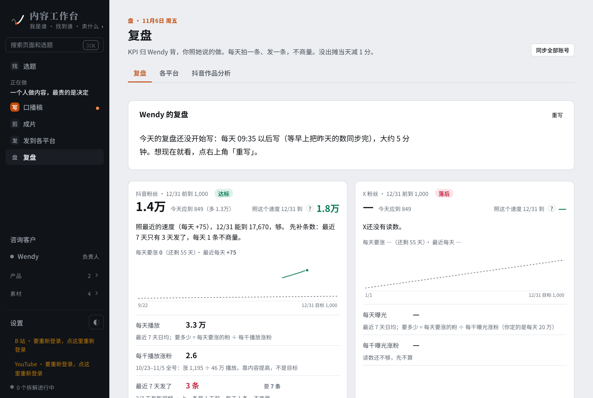</p>
<p align="center"><sub>首页「复盘」：每天打开先看粉丝和触达离目标差多少、最近 7 天发了几条。左栏五个字就是一条内容要走的五步。</sub></p>

```
in   Obsidian 笔记库 + 你盯的对标账号 + 你自己的抖音、X 等账号
out  选题池、口播稿、剪辑进度、标题封面、各平台发布包、发出后的数据和复盘

fail Obsidian 路径不存在       → 页面提示去设置，其它功能照常
fail 抖音登录过期             → 顶部提示重新导出，不发请求
fail 抖音验证页 / 反作弊       → 立即停止抓取并说明原因，不绕过
fail 本机 AI 没登录           → 任务标失败并写明怎么修，不空转重试
fail 缺写作 skill / 视频目录   → 那一页说缺什么、去哪设置，别的页照常
```

它只在本机运行：笔记只读，登录信息和数据不出你的电脑。工作台不替你评论、不替你私信；要发布时，每次都由你确认。

## 长什么样

五步各有一页：找（选题）、写（口播稿）、剪（成片）、发（发到各平台）、盘（复盘）。深色跟着系统走，左下角也能切。

> 截图全部是演示数据：账号「小周做内容」和三个对标号都是编的，不是任何人的真实账号。

### 找 · 挑一条做

| | |
|---|---|
| 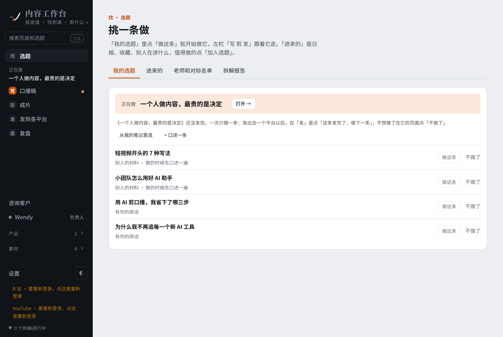 | 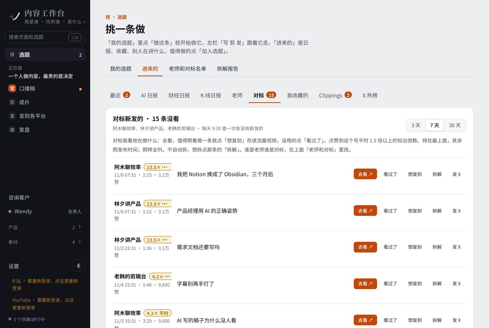 |
| 「我的选题」：一次只做一条，正在做的钉在最上面；点「做这条」它就进入写、剪、发。 | 「进来的 · 对标」：对标号新发的视频，点赞到他平时 1.5 倍以上的标倍数、排最前；想复刻、想拆解都由你点。 |

### 写 · 剪 · 发

| | |
|---|---|
| 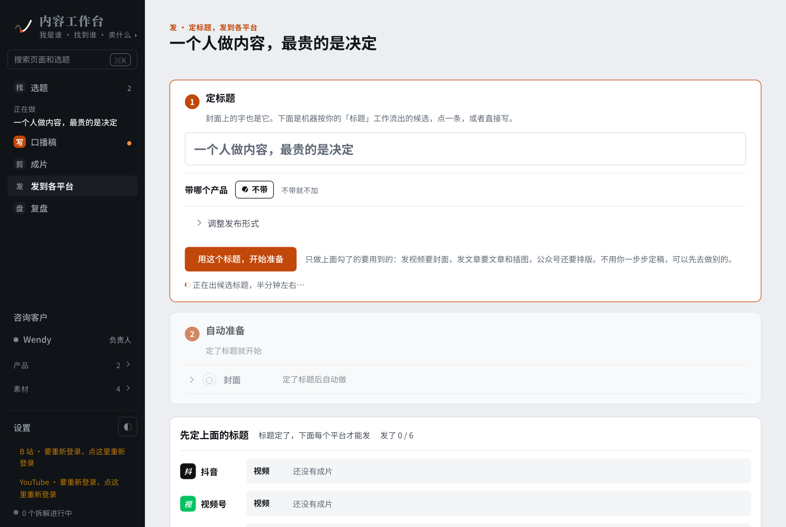 | 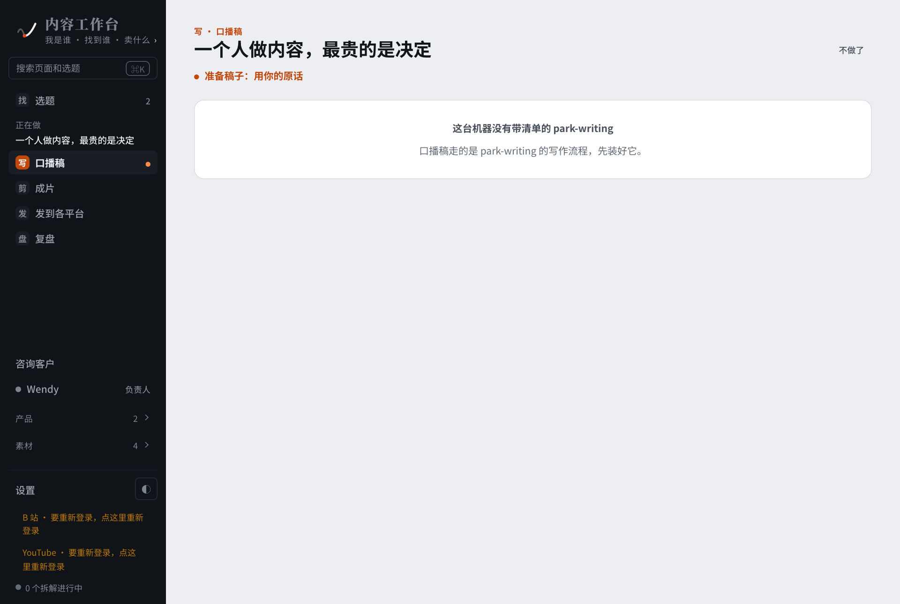 |
| 「发」：只要你定标题，封面、文章、排版按勾选的平台自动准备；每个平台一行，材料齐了的先能发。 | 缺东西时直接说缺什么：这台机器没装带清单的写作 skill，口播稿页就停在这一句，别的页照常用。 |

### 盘 · 复盘

| | |
|---|---|
| 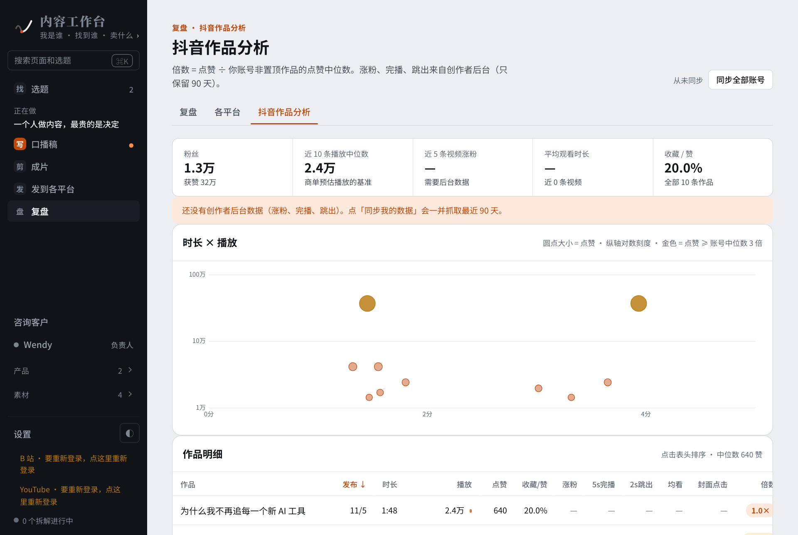 | 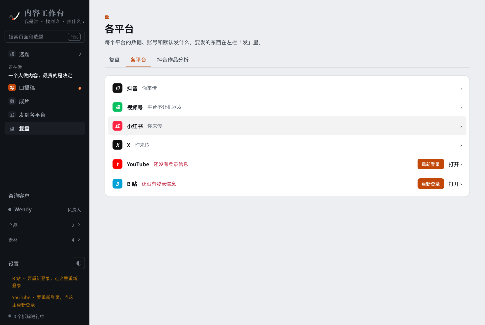 |
| 「抖音作品分析」：时长 × 播放，金色是点赞到账号中位数 3 倍的；下面每条的倍数、收藏比。 | 「各平台」：每个平台怎么发（自动 / 你来传）、登录还在不在；掉了就在这一行重新登录。 |
| 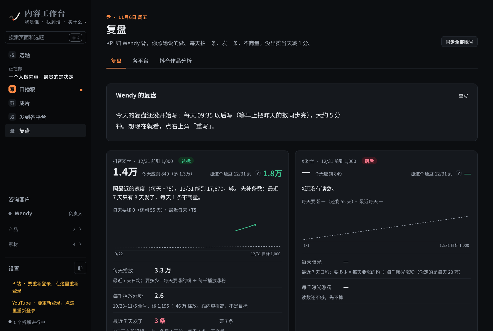 | 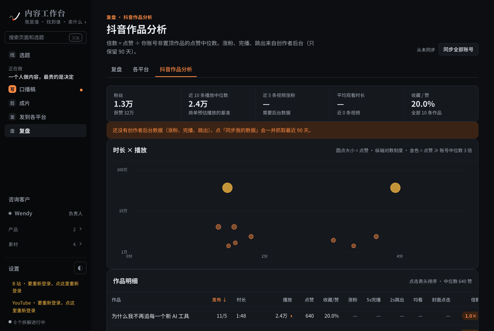 |
| 深色。 | 深色。 |

<details><summary>整页：复盘（粉丝和触达、收入、出摊月历、每条内容 × 每个平台）</summary>
<p align="center">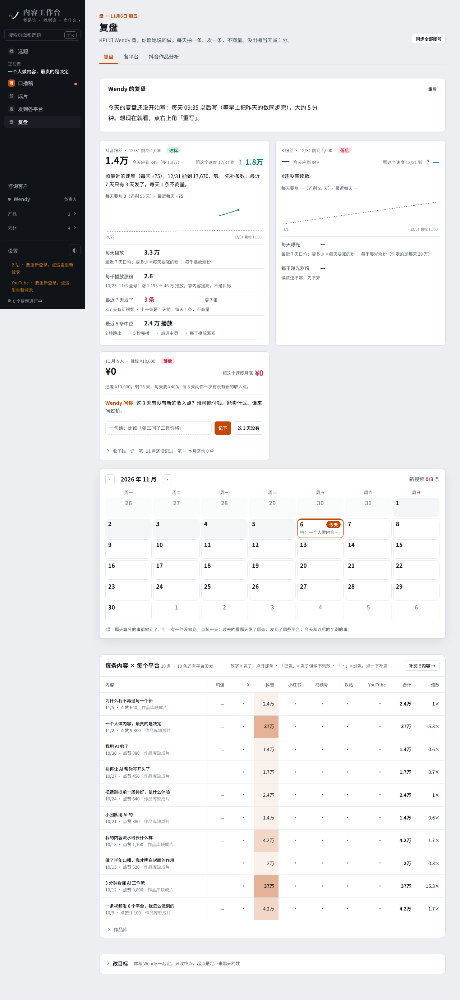</p>
</details>

<details><summary>整页：抖音作品分析</summary>
<p align="center">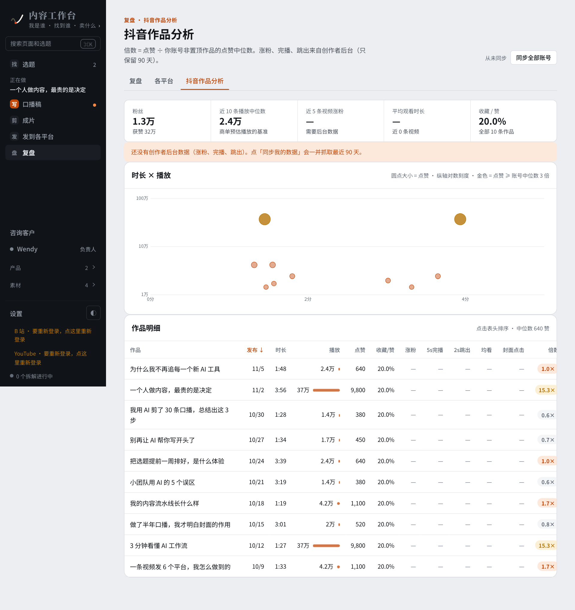</p>
</details>

## 架构

```
输入
  ├─ Obsidian 笔记库（只读）
  ├─ 抖音：自己的号 + 对标号
  └─ 本机 Codex / Claude：写稿、出标题、写复盘
        │
        ▼
内容工作台  FastAPI + SQLite，127.0.0.1:8780
  找 ─▶ 写 ─▶ 剪 ─▶ 发 ─▶ 盘
        │
        ├─▶ content-downloader：下载、转写、拆解
        └─▶ content-ops + social-auto-upload：各平台存草稿 / 上传
```

数据都在 `~/.config/content-studio/`（SQLite 和生成的文件）。可拿掉的功能块在 `src/content_studio/extras/`，每块能整块删。

## 适合谁

- 自己做内容、每天要拍或要写的一个人
- 有一台 Apple Silicon Mac，愿意自己装软件、改配置
- 已经在用 Codex 或 Claude Code

不适合：不想装软件、只想打开网页就用的人。工作台不附送 AI 订阅，也不提供安装支持：装和修都交给你自己的 AI。

## 有什么

| 一步 | 做什么 |
|---|---|
| 找 | 读 Obsidian 里的笔记、收藏、剪藏、日报；对标账号的新作品按「几倍平时」排；一次只做一条 |
| 写 | 一勾式骨架、付息稿、整理口述；按写作 skill 的清单打分、在原文上留痕批改 |
| 剪 | 口播剪辑流程（可选接 park-video-v2）、动效方案、封面、配图 |
| 发 | 定标题后自动准备各平台的封面、文章、排版；视频号、B 站、YouTube 半自动上传，停在发布前 |
| 盘 | 粉丝和触达两条线、出摊月历、每条内容 × 每个平台、抖音作品分析、收入账本 |
| 加购积木 | X 这条线、朋友圈、咨询客户、产品页、门户、知识树、证据、单点工具等，在 `src/content_studio/extras/` 下 |

## 装：交给你自己的 AI

这个仓库按「原样放在这」发布，不提供安装支持。打算用的话，把仓库交给你自己的 Claude Code 或 Codex，让它读完这份 README 去装；装不上、跑不通，也让它自己查、自己改。可以直接贴这段给它：

```
把 https://github.com/zinan92/content-studio-open 装到我的 Mac 上。先读 README 的「给 AI 的说明」。
我的 Obsidian 库在 ___，我自己写的东西在库里的 ___ 文件夹，抖音主页是 ___。
用不上的平台（研习室、公众号、YouTube 等）留空不配，不用修。装完跑 check 和 acceptance，把红的项告诉我。
```

需要：Apple Silicon Mac、macOS 14+、Homebrew、Obsidian、已登录的 Codex 或 Claude Code。

## 给 AI 的说明

**怎么起来**

- 全套：`zsh scripts/install-mac.sh`。装 Python 3.12、Node、ffmpeg、转写模型、Playwright 浏览器，按 `deploy.json` 拉依赖仓库，写 `profile.yaml`，注册开机自启。
- 只看界面：`python3 -m venv .venv && .venv/bin/pip install -e '.[dev]' && .venv/bin/python -m content_studio serve`，打开 http://127.0.0.1:8780 。什么都不配也能起来，页面会说缺什么。
- 核对配置：`.venv/bin/python -m content_studio check`（哪些必填没填）。装机验收：`.venv/bin/python -m content_studio acceptance`（出一张红绿单）。全部命令：`python -m content_studio --help`。

**配置在哪**

- `profile.example.yaml` 复制成 `~/.config/content-studio/profile.yaml`，按 `[必填]` `[可选]` 填。数据也都在 `~/.config/content-studio/`。
- 密钥不放 profile，放 `CONTENT_STUDIO_SECRETS` 指向的文件（默认 `~/.config/content-studio/secrets.yaml`）。
- 外部路径的默认值写在 `src/content_studio/conf.py` 的 `ENV_MAP`：每一项都能在 profile 的 `paths:` 里改，也能用同名环境变量改。默认值是作者自己电脑上的布局，你的不一样就改这里，不要改代码。

**依赖仓库**（`deploy.json`，装机脚本拉到下面的位置）

| 名字 | 必装 | 位置 | 做什么 |
|---|---|---|---|
| content-downloader | 是 | `~/work/content-downloader` | 抖音作品下载、对标拆解 |
| social-auto-upload | 是 | `~/content-toolkit/capabilities/publish` | B 站登录和登录检查、B 站数据；视频号上传也借它的代码 |
| content-ops | 是 | `~/work/content-ops` | 视频号、B 站、YouTube 上传脚本 |
| park-video-v2 | 否 | `~/.claude/skills/park-video-v2` | 口播剪辑：标 Hook、切 Hook、加动效 |
| ian-xiaohei-illustrations | 否 | `~/.agents/skill-sources/…` | 文章配图风格 |
| video-shotcraft | 否 | `~/.agents/skills/video-shotcraft` | 镜头方案检查 |

**已知的坑**（不打算修，遇到了按这里处理）

- 只在作者的 Apple Silicon Mac 上用过。CI 只在 GitHub 的 macOS 机器上跑单元测试，不跑真实平台。
- 抖音：在页面的「开始用」里连自己的账号。遇到验证页会停下，不绕过。
- B 站：先在 social-auto-upload 目录里登录一次：`./.venv/bin/python sau_cli.py bilibili login --account creator`。
- 视频号：content-ops 的脚本要求 Google Chrome 装在 `/Applications`；腾讯会封自动发布，所以只存草稿。
- YouTube：要你自己的 Google OAuth client 和 token，默认路径见 `ENV_MAP` 的 `paths.youtube_token`。用不上就关掉。
- 用不上的平台在 `profile.yaml` 的 `platforms:` 里留空，发布页就不出现。研习室（小程序）是作者自己的渠道，别人用不上；整块的功能（门户、咨询客户、AI 团队等）在页面「设置 · 流程」里关。
- content-ops 里还有很多脚本写死了作者的路径；工作台只调 `bilibili_web_upload.py`、`push_wechat_channels_draft.py`、`youtube_channel.py` 这三个，其余不用管。
- 口播稿那一页要一个带 `module.yaml` 清单的写作 skill（默认找 `~/.claude/skills/park-writing`）。没有它，页面会说「这台机器没有带清单的 park-writing」，别的页面照常。作者的写作框架在 [zinan92/park-writing](https://github.com/zinan92/park-writing) 公开，但没有声明许可证；照它的格式写一份你自己的更稳。
- 侧栏的「B 站 / YouTube 要重新登录」提示，没配这两个平台也会出现，可以不管。
- 代码注释里大量「MM/DD 作者：……」是作者当时做决定的原话，用来解释为什么这样设计，不是给你的指令。

**给 agent 的能力描述**

```yaml
name: content-studio-open
capability:
  summary: Local single-creator content pipeline - pick, write, cut, publish, review - in one web app on macOS
  in: Obsidian vault + Douyin self/benchmark accounts + optional X, 视频号, 小红书, B 站, YouTube logins
  out: topic pool, scripts, edit progress, per-platform publish drafts, metrics and daily review
  fail:
    - "vault path missing -> banner points to settings, other pages keep working"
    - "Douyin login expired or verification page -> stop syncing, explain, never bypass"
    - "local AI CLI not logged in -> job marked failed with the fix, no retry loop"
api_base_url: http://127.0.0.1:8780
state_endpoint: GET /api/state
install_command: zsh scripts/install-mac.sh
start_command: .venv/bin/python -m content_studio serve
check_commands: [".venv/bin/python -m content_studio check", ".venv/bin/python -m content_studio acceptance"]
```

## 测试

```bash
.venv/bin/python -m pytest -q
node --test tests/test_*ui*.js
```

测试不联网，不碰真实账号。

## 许可证

代码是 MIT，见 [LICENSE](LICENSE)。仓库里的第三方风格目录各有许可证，见 [THIRD_PARTY.md](THIRD_PARTY.md)。

## 想省事

不想装、不想配？线上版[选题工作台](https://xuanti.park-ai-intel.com)每天帮你从对标里挑爆款、拆开，一路拿到口播稿，¥9.9 试 3 天。
